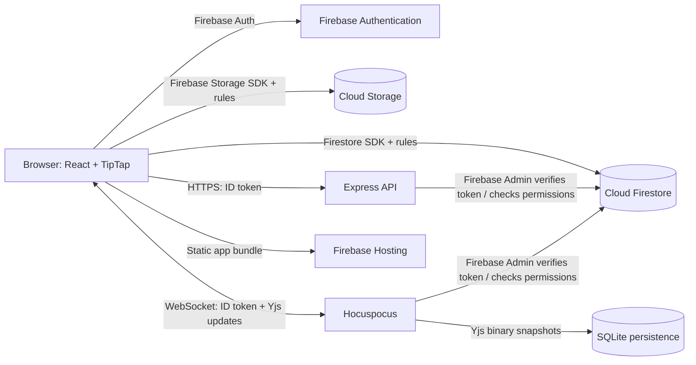

# CloudSync

CloudSync is a cloud-based document workspace for creating, organizing, sharing, and editing documents together. It is built as a full-stack university cloud-computing project: Firebase provides real authentication, metadata, and file storage; a Node.js service verifies access and runs the Yjs/Hocuspocus collaboration server.

## Problem and objectives

Teams often lose time passing around document copies and cannot tell which version is current. CloudSync keeps one shared document, gives invited people viewer or editor access, automatically saves collaborative edits, and offers a basic snapshot history.

## Features

- Firebase email/password registration, login, Google sign-in, password reset, and persistent sessions.
- Profile settings, responsive workspace, search, sorting, recent/shared/starred/trash views, and dark mode.
- Rich text editor with headings, lists, alignment, bold/italic/underline/strike, color, highlight, links, images, tables, quotes, undo, and redo.
- Simultaneous editing and cursor presence via Tiptap, Yjs, Awareness, and Hocuspocus over WebSockets.
- Hocuspocus SQLite persistence for binary Yjs document state; Firestore stores metadata, access permissions, and version snapshots.
- Owner-managed invitations by registered email with viewer/editor roles. The server validates Firebase ID tokens and checks permission before opening collaboration rooms.
- Autosaved document metadata and Yjs state, manual and periodic snapshots, version restoration, and HTML/PDF/DOCX export.
- Firebase Storage image uploads with MIME type and 5 MB size checks.
- Firestore and Storage security rules, server-side authorization, rate limiting, and deployment configuration.

## Technology

React, Vite, JavaScript, Tailwind CSS, React Router, Lucide, TipTap, ProseMirror, Yjs, Hocuspocus, Node.js, Express, Firebase Authentication, Cloud Firestore, Firebase Storage, Firebase Hosting, Vitest, and React Testing Library.

## Architecture



See [docs/architecture.md](docs/architecture.md), [docs/database-schema.md](docs/database-schema.md), [docs/firebase-setup.md](docs/firebase-setup.md), [docs/deployment.md](docs/deployment.md), and [docs/testing.md](docs/testing.md).

## Project structure

```text
.
├── backend/                 Express APIs, Firebase Admin, Hocuspocus, SQLite
├── docs/                    Architecture, setup, deployment, testing
├── src/
│   ├── components/          Workspace, document cards, sharing dialog
│   ├── context/             Firebase authentication context
│   ├── pages/               Auth, dashboard, editor, shared, recent, settings
│   ├── services/            Firebase, auth, document, storage, API
│   └── styles/              Responsive app styling
├── firestore.rules
├── storage.rules
├── firebase.json
└── .env.example
```

## Requirements

- Node.js 22 or later and npm. Hocuspocus 4 requires Node 22+.
- A Firebase project with Authentication, Firestore, and Storage enabled.
- A Firebase service account or application default credentials for the backend. Never put an Admin key in frontend variables or source control.

## Local development

1. Create a Firebase project, enable Email/Password and Google providers, create Firestore and Storage, and add a Firebase Web App. Follow [docs/firebase-setup.md](docs/firebase-setup.md).
2. Copy `.env.example` to `.env.local` and fill in the Firebase **web app** settings. These `VITE_FIREBASE_*` values are public client configuration, protected by Firebase rules; they are not service account credentials.
3. Copy `backend/.env.example` to `backend/.env`. Set `FIREBASE_PROJECT_ID`, `CLIENT_ORIGIN`, and either `GOOGLE_APPLICATION_CREDENTIALS` to a service account file stored outside this repository or use application default credentials. Never commit that file or put it under `src/`.
4. Install the packages in the root and backend folders:

   ```bash
   npm install
   npm --prefix backend install
   ```

5. Start the collaboration/API backend and Vite in separate terminals:

   ```bash
   npm run server
   npm run dev
   ```

   The browser app runs at `http://localhost:5173`, the Express API at `http://localhost:4000`, and Hocuspocus at `ws://localhost:4001`. `COLLAB_DATABASE` defaults to `backend/data/collaboration.sqlite` when started from the project root; this SQLite file is ignored by Git.

6. Register at least two accounts to demonstrate sharing and concurrent editing. Use an account that exists in CloudSync to invite by email.

The Firebase web integration cannot read or write until `.env.local` contains a real project configuration. Sharing and the collaboration server additionally require backend Admin credentials. With no Firebase credentials the API health endpoint still starts, but authenticated operations correctly fail; the app does not replace Firebase with mock data.

## Environment variables

Frontend (`.env.local`): `VITE_FIREBASE_API_KEY`, `VITE_FIREBASE_AUTH_DOMAIN`, `VITE_FIREBASE_PROJECT_ID`, `VITE_FIREBASE_STORAGE_BUCKET`, `VITE_FIREBASE_MESSAGING_SENDER_ID`, `VITE_FIREBASE_APP_ID`, `VITE_API_URL`, and `VITE_COLLAB_URL`.

Backend (`backend/.env`): `PORT`, `COLLAB_PORT`, `CLIENT_ORIGIN`, `FIREBASE_PROJECT_ID`, `GOOGLE_APPLICATION_CREDENTIALS` or `FIREBASE_SERVICE_ACCOUNT_JSON`, and `COLLAB_DATABASE`. Server credentials are private and must remain server-side.

## Testing

```bash
npm test
npm run build
```

Cloud end-to-end checks require a configured Firebase project, Admin credentials, two real accounts, and the API/WebSocket services. Follow the runnable/manual checks in [docs/testing.md](docs/testing.md). Do not treat Firebase-dependent flows as verified until run against your configured project.

## Deployment

Build the client with `npm run build` and deploy Firebase Hosting, Firestore rules/indexes, and Storage rules with the Firebase CLI. Deploy `backend/` to a Node.js 22+ service with persistent disk for SQLite and support for long-lived WebSockets; point the frontend at the deployed API and `wss://` collaboration URL. Firebase Hosting does not run the persistent collaboration server. Detailed steps are in [docs/deployment.md](docs/deployment.md).

## Cloud computing concepts demonstrated

- **SaaS:** the workspace is accessed in a browser without installing a desktop client.
- **Cloud identity:** Firebase Authentication manages accounts and ID tokens.
- **Cloud database:** Firestore stores users, document metadata, permissions, versions, and activity records.
- **Cloud object storage:** Firebase Storage holds uploaded image assets.
- **Real-time distributed state:** Yjs CRDT updates flow over Hocuspocus WebSockets and merge concurrent edits.
- **Authorization:** Firestore/Storage rules protect direct client access; Express and Hocuspocus independently verify identity and document role.
- **Availability and multi-device access:** cloud metadata/files and the deployed collaboration endpoint are reachable from supported devices. The local SQLite collaboration store is single-instance and is not a horizontally scalable production store.

## Limitations and future work

- Collaboration state uses SQLite on the backend host. For multi-instance scaling, replace it with a shared durable database/object store plus Hocuspocus Redis coordination and ensure deployed persistent storage/backups.
- Version history is a JSON snapshot feature. It does not record a full per-keystroke audit trail or provide a side-by-side diff.
- PDF export opens the browser print dialog; choose “Save as PDF”. DOCX exports paragraph and list text; rich formatting and image/table fidelity may vary.
- Sharing requires the recipient to register first. Google OAuth provider setup and authorized domains are configured in Firebase.
- Uploads currently support document images only (PNG, JPG, GIF, WebP up to 5 MB); arbitrary attachments are not exposed in the UI.
- The workspace has not been exercised against a specific Firebase project until project credentials are supplied.
